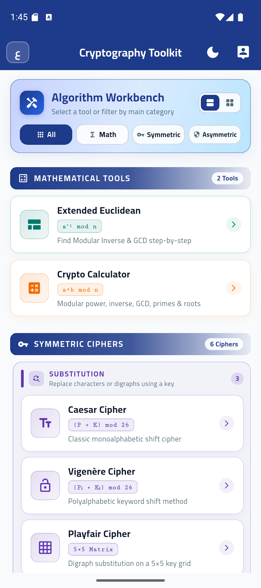
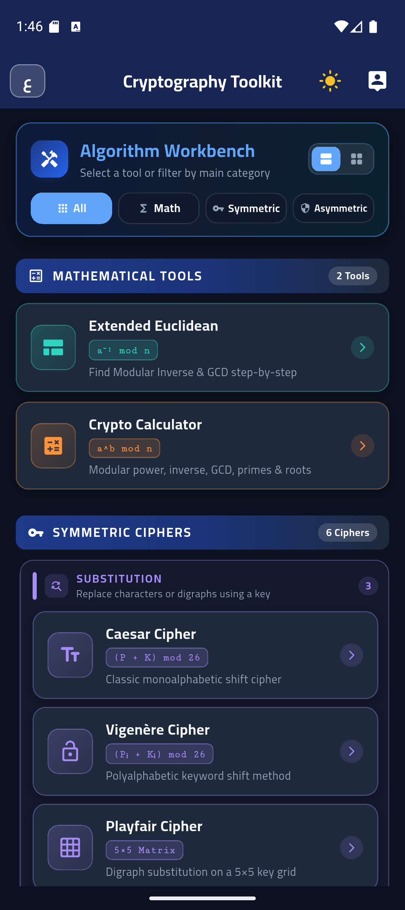
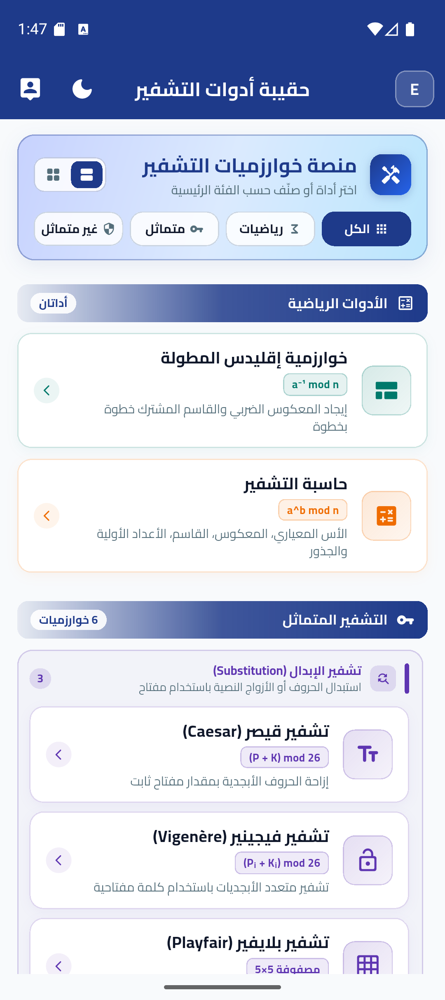
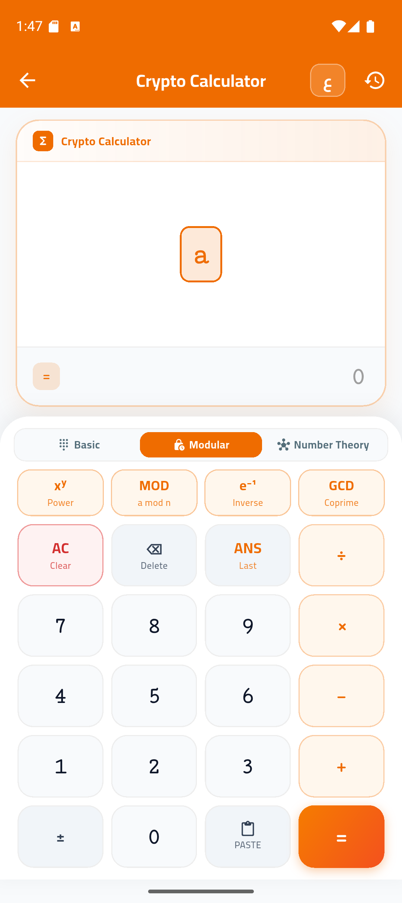
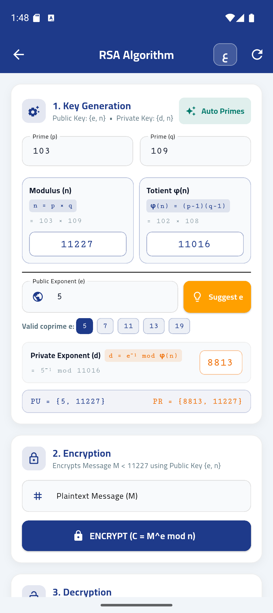
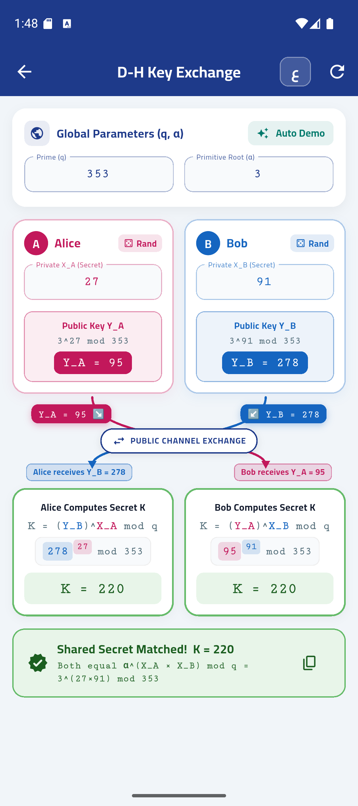
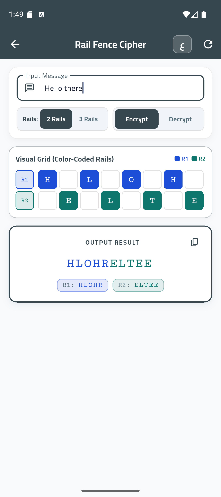
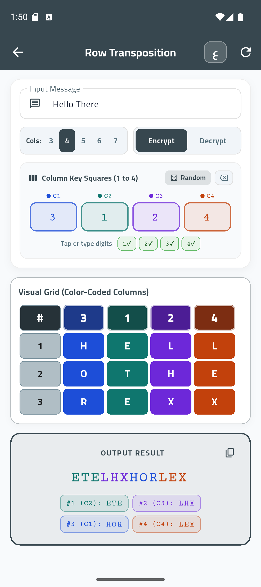

# 🔐 Cryptography Toolkit

### Explore cryptography. Understand the mathematics. See every step.

**An interactive educational workbench for cryptography and number theory, built with Flutter.**

[**🌐 Try the Web App**](https://srfalah.github.io/Cryptography-Toolkit/) · [**📱 Download Android APK**](https://github.com/srfalah/Cryptography-Toolkit/releases/latest) · [**🗂 View Releases**](https://github.com/srfalah/Cryptography-Toolkit/releases)

---

## Why Cryptography Toolkit?

Cryptography Toolkit is designed for **computer science and cybersecurity students, instructors, and curious learners**. Rather than returning only a ciphertext or a numerical answer, it makes algorithmic processes visible through interactive tables, formula substitutions, matrices, key-exchange diagrams, and step-by-step calculations.

The interface is designed for mobile screens and supports both **English and Arabic**, with correct right-to-left layouts and left-to-right mathematical notation.

## ✨ Highlights

- **11 interactive learning tools** spanning number theory, public-key cryptography, substitution ciphers, and transposition ciphers.
- **Visual, step-by-step explanations** of calculations and cryptographic transformations.
- **English / Arabic interface** with instant language switching, RTL support, and an included Cairo font for Arabic text.
- **Light and dark themes** throughout the workbench and its tools.
- **Mobile-first layout** with category filters and switchable list / two-column grid views.
- **Interactive cipher visuals**, including colored zigzag rails, column matrices, key alignment, and public-key exchange stages.
- **Android and browser access**: download the Android APK or use the web version on an iPhone, iPad, or desktop browser.

## 📸 Screenshots

<!-- SCREENSHOTS TO BE CAPTURED FROM v3.1.2 AND ADDED BEFORE PUBLISHING.
     Place the real screenshots in screenshots/v3.1.2/ with the exact filenames below.
     These image references are placeholders until those files are added. -->

<table>
<tr>
<td align="center" width="50%"> <strong>Algorithm Workbench · Light</strong></td>
<td align="center" width="50%"> <strong>Algorithm Workbench · Dark</strong></td>
</tr>
<tr>
<td align="center"> <strong>Arabic / RTL Interface</strong></td>
<td align="center"> <strong>Crypto Calculator</strong></td>
</tr>
<tr>
<td align="center"> <strong>RSA Cryptosystem</strong></td>
<td align="center"> <strong>Diffie-Hellman Key Exchange</strong></td>
</tr>
<tr>
<td align="center"> <strong>Rail-Fence Cipher</strong></td>
<td align="center"> <strong>Row Transposition Cipher</strong></td>
</tr>
</table>

## 🧰 Explore the 11 Tools

### 🟠 Math & Number Theory

| Tool | What you can explore |
| --- | --- |
| **Crypto Calculator** | Modular operations, modular exponentiation and inverses, primitive-root checks, GCD, LCM, Euler's totient, primality, nearby primes, prime factorization, and calculation history. |
| **Extended Euclidean Algorithm** | A full quotient/remainder table, GCD calculation, and the steps used to find a modular inverse. |

### 🟣 Public-Key Cryptography

| Tool | What you can explore |
| --- | --- |
| **RSA Cryptosystem** | Prime selection, computing `n` and `φ(n)`, selecting valid public exponents, deriving the private exponent, and encrypting/decrypting messages. |
| **Diffie-Hellman Key Exchange** | Public parameters, primitive-root validation, Alice and Bob's public/private values, the visual key exchange, and shared-secret verification. |
| **El-Gamal Cryptosystem** | Parameter setup, key generation, encryption components (`C1`, `C2`), and decryption calculations. |

### 🔵 Substitution Ciphers

| Tool | What you can explore |
| --- | --- |
| **Caesar Cipher** | Encryption/decryption with a configurable shift and a live alphabet-mapping view. |
| **Vigenère Cipher** | Polyalphabetic encryption/decryption with message and repeated-key alignment. |
| **Playfair Cipher** | A live 5×5 key matrix and digraph-by-digraph transformations. |

### 🟢 Transposition Ciphers

| Tool | What you can explore |
| --- | --- |
| **Rail-Fence Cipher** | Two-rail or three-rail zigzag patterns with color-coded rows and matching ciphertext segments. |
| **Row Transposition Cipher** | Three to seven columns, auto-advancing key squares, permutation keys, and a color-coded transposition matrix. |
| **Route Cipher** | Spiral clockwise, spiral counter-clockwise, vertical snake, and horizontal snake traversal routes with numbered grid steps. |

## 🚀 What's New in v3.1.2?

- **Two additional classical ciphers:** Playfair and Route Cipher.
- **A redesigned Algorithm Workbench:** category filters, formula badges, refined cards, and a list/grid layout toggle.
- **Bilingual accessibility:** instant English/Arabic switching, RTL layout, and bundled offline Cairo typography.
- **Consistent light and dark themes** across all 11 tools.
- **Clearer public-key demonstrations** in RSA, Diffie-Hellman, and El-Gamal, with inline formulas and validation feedback.
- **More expressive classical-cipher interfaces:** segmented mode controls, interactive transposition key squares, and color-coded cipher visualizations.
- **Improved mobile readability**, including a compact Extended Euclidean steps table.

## 📲 Try the App

### Android

Download the APK from the [latest GitHub release](https://github.com/srfalah/Cryptography-Toolkit/releases/latest). Open the downloaded APK on your Android device and follow Android's installation prompts.

### iPhone, iPad, or Desktop

Use the browser-based Flutter app: **[Launch Cryptography Toolkit Web](https://srfalah.github.io/Cryptography-Toolkit/)**.

> **Note:** The web version runs in the browser. It is not a native iOS app.

## 🎓 Educational Use

The tools are intended for **learning, exploration, and classroom demonstrations**. Classical ciphers and classroom-sized public-key examples are not substitutes for production-grade cryptographic libraries or secure applications.

## 👨‍💻 Developer

Developed by **Sultan Al-Falah**.

##
##
##

